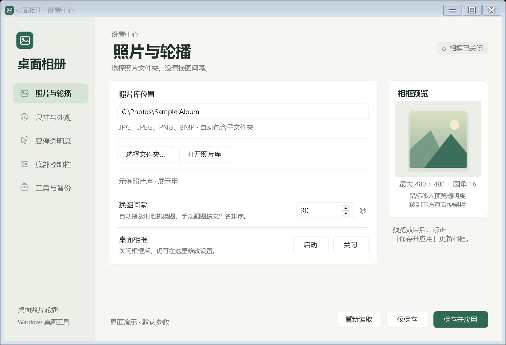

# 桌面相册 / Desktop Album

[中文](#中文) · [English](#english)



## 中文

在 Windows 桌面上轮播照片的小相框，基于 [Rainmeter](https://github.com/rainmeter/rainmeter) 和 [Reminisce](https://github.com/misterhaan/Reminisce) 修改，配有设置中心。

照片保持原比例，可设置相框大小、圆角、阴影和描边。鼠标移入时相框逐渐变透明，仍可拖动和双击。移到照片底部会出现控制栏，可以翻图、暂停或打开原图。自动播放随机换图，手动翻图按文件名排序。

### 使用便携版

完整解压 [DesktopAlbum-v1.0.zip](https://github.com/tongxuedashu-design/DesktopAlbum/releases/download/v1.0/DesktopAlbum-v1.0.zip)，双击 `DesktopAlbum.exe`。选择照片文件夹后，点击「保存并应用」。便携包已附引擎，不需要另外下载或编译。

支持 Windows 10/11 64 位，需启用 .NET Framework 4.x。便携版目录采用 `Engine`、`Config`、`Photos`、`Docs`。更多操作见 [使用说明](docs/USER_GUIDE.md)。

### 从源码运行

此源码包包含设置中心、相框皮肤、Lua 脚本和构建脚本。便携版中的 `Docs/sources` 同时提供本源码包和 Rainmeter 的对应版本源码。

开发时，从 [Rainmeter 官网](https://www.rainmeter.net/)下载 64 位版本，用安装器的便携模式解压到独立文件夹。在本 README 所在目录打开 Windows PowerShell，执行以下命令，将示例路径换成自己的 Rainmeter 目录。

```powershell
& '.\src\Prepare.ps1' -RainmeterDirectory 'C:\Tools\Rainmeter'
& '.\runtime\DesktopAlbum.exe' --start-frame
```

准备脚本会复制引擎、初始化运行配置并编译程序。构建使用 Windows 自带的 C# 编译器，不需要 NuGet、Python 或 Node.js。修改代码后，从托盘退出开发副本的设置中心，再重新构建。

```powershell
& '.\src\Build.ps1'
& '.\src\Test.ps1'
# 会临时修改开发副本的照片库，检查结束后恢复
& '.\src\Test.ps1' -IncludeLive
```

普通检查使用独立的临时配置。`-IncludeLive` 需要先准备引擎，并且只应对专用的开发副本运行。测试不移动鼠标。

| 目录 | 内容 |
| --- | --- |
| `src` | C# 源码、图标和 PowerShell 脚本 |
| `runtime/Config` | 默认配置模板、相框皮肤和 Lua 脚本 |
| `runtime/Photos` | 绘制的示例图和照片库说明 |
| `docs` | 双语指南、演示截图和上游许可 |
| `artifacts` | 开发运行后生成的测试结果和备份，不进入源码发布包 |

`Program.cs` 处理启动、保存和相框控制，`SettingsStore.cs` 处理设置读写。布局在 `SettingsForm.Design.cs`，绘制和动画在 `Theme.cs`，相框脚本在 `runtime/Config/Skins/Reminisce/@Resources/AutoSize.lua`。

### 来源与发布

Rainmeter 使用 GPL v2。Reminisce 的仓库 LICENSE 标为 MIT，皮肤 Metadata 另标 CC BY-NC-SA 3.0。新增代码尚未指定发布许可证，具体说明见 [LICENSE.md](LICENSE.md)。

本目录只放源码、默认模板、绘制的示例图和演示截图。个人照片、实际配置、聊天、备份、日志和快捷方式未打包。文件与 SHA-256 见 `source-manifest.json`。公开发布时使用这份独立源码，详见 [分发文件说明](docs/DISTRIBUTION.md)。

## English

A Windows desktop photo frame based on [Rainmeter](https://github.com/rainmeter/rainmeter) and [Reminisce](https://github.com/misterhaan/Reminisce), with a settings center.

Photos keep their aspect ratio. Frame size, corners, shadow, and outline can be adjusted. The frame fades when hovered and remains draggable and clickable. Controls appear near the bottom for previous/next, pause/resume, and opening the original image. Automatic playback chooses photos at random; manual navigation follows filename order.

### Using the portable release

Extract [DesktopAlbum-v1.0.zip](https://github.com/tongxuedashu-design/DesktopAlbum/releases/download/v1.0/DesktopAlbum-v1.0.zip) completely and double-click `DesktopAlbum.exe`. Select a photo folder and click 「保存并应用」 (Save and apply). The engine is included in the portable release; no separate download or compilation is needed.

Requires 64-bit Windows 10/11 with .NET Framework 4.x enabled. Portable folders are named `Engine`, `Config`, `Photos`, and `Docs`. The interface currently uses Chinese; the [user guide](docs/USER_GUIDE.md) explains its controls in English.

### Building from source

This archive includes the settings center, skin, Lua script, and build scripts. The portable release's `Docs/sources` folder contains this archive and the corresponding Rainmeter source.

For development, download 64-bit Rainmeter from its [official website](https://www.rainmeter.net/) and use the installer's portable mode to extract it to a separate folder. Open Windows PowerShell in the directory containing this README. Replace the example Rainmeter path below with your own.

```powershell
& '.\src\Prepare.ps1' -RainmeterDirectory 'C:\Tools\Rainmeter'
& '.\runtime\DesktopAlbum.exe' --start-frame
```

The prepare script copies the engine, initializes the runtime configuration, and compiles the app. Compilation uses the C# compiler included with Windows, with no NuGet, Python, or Node.js dependency. After editing code, exit the development copy's settings center from the tray before rebuilding.

```powershell
& '.\src\Build.ps1'
& '.\src\Test.ps1'
# Temporarily changes the development copy's library and restores it afterward
& '.\src\Test.ps1' -IncludeLive
```

Regular checks use a separate configuration fixture. `-IncludeLive` requires a prepared engine and should be run only against a dedicated development copy. Tests do not move the mouse.

| Folder | Contents |
| --- | --- |
| `src` | C# source, icon, and PowerShell scripts |
| `runtime/Config` | Default templates, skin, and Lua script |
| `runtime/Photos` | Drawn sample image and library notes |
| `docs` | Bilingual guides, demonstration screenshots, and upstream licenses |
| `artifacts` | Generated test results and development backups; excluded from source releases |

`Program.cs` handles startup, saving, and frame control. `SettingsStore.cs` reads and writes settings. Layout is in `SettingsForm.Design.cs`, drawing and animation in `Theme.cs`, and the skin script in `runtime/Config/Skins/Reminisce/@Resources/AutoSize.lua`.

### Attribution and distribution

Rainmeter is licensed under GPL v2. Reminisce's repository LICENSE specifies MIT, while the skin Metadata specifies CC BY-NC-SA 3.0. The newly added code does not yet have a selected release license. See [LICENSE.md](LICENSE.md) for the details.

This directory contains source, default templates, a drawn sample image, and synthetic screenshots. It excludes personal photos, active configurations, chats, backups, logs, and local shortcuts. `source-manifest.json` lists files and SHA-256 hashes. Use this separate source tree when publishing; see [distribution notes](docs/DISTRIBUTION.md).
